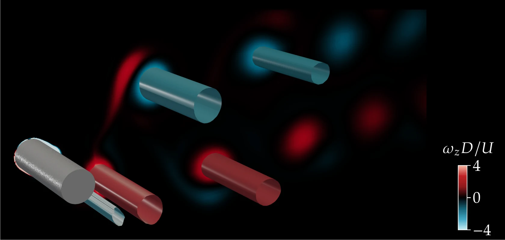

# Vortex-induced vibration

**An elastically mounted cylinder shaking in its own wake, in OpenFOAM.**

<p align="center"></p>

One script writes a complete OpenFOAM case for a cylinder on a spring and damper, free to move across the flow, with the set-up of the papers below. The original simulations used ANSYS Fluent and are not available; this is a re-implementation for OpenFOAM v2412 (openfoam.com).

## Get started

```bash
git clone https://github.com/EngFlavioMartins/vortex-induced-vibration.git
cd vortex-induced-vibration
python src/make_case.py runs/vstar7 --vstar 7 --two-d
cd runs/vstar7 && ./Allrun
```

Run `./Allrun` in an OpenFOAM v2412 environment. `--vstar` sets the reduced velocity and `--zeta` the damping ratio. Leave out `--two-d` for the three-dimensional case (much slower). `python scripts/response.py runs/vstar7` reports the amplitude and frequency.

## Make the figure above

```bash
reconstructPar -case runs/vstar7 -time '15:18'
sh scripts/render/make_figure.sh runs/vstar7 16.669072
```

You need [ParaView](https://www.paraview.org/download/) (for `pvpython`), a LaTeX installation, and `pip install pyvista pillow`. The figure comes from a coarse two-dimensional run (amplitude 0.66 D): treat it as qualitative, below the upper-branch response of the paper's three-dimensional simulations.

## Cite

This code follows the set-up of the papers below. If you use it, please cite:

```bibtex
@article{martins2019viv3d,
  author  = {Martins, Flavio A. C. and Avila, J. P. J.},
  title   = {Three-Dimensional {CFD} Analysis of Damping Effects on Vortex-Induced Vibrations of {2DOF} Elastically-Mounted Circular Cylinders},
  journal = {Marine Structures},
  volume  = {65},
  pages   = {12--31},
  year    = {2019},
  doi     = {10.1016/j.marstruc.2019.01.005}
}

@article{martins2019vivre,
  author  = {Martins, Flavio A. C. and Avila, J. P. J.},
  title   = {Effects of the {Reynolds} Number and Structural Damping on Vortex-Induced Vibrations of an Elastically-Mounted Rigid Cylinder},
  journal = {International Journal of Mechanical Sciences},
  volume  = {156},
  pages   = {235--249},
  year    = {2019},
  doi     = {10.1016/j.ijmecsci.2019.03.024}
}
```

GitHub's **Cite this repository** button (from [CITATION.cff](CITATION.cff)) gives the same reference in other formats.

## Licence

MIT; see [LICENSE](LICENSE).
